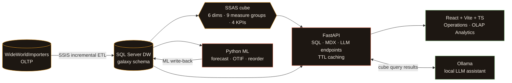
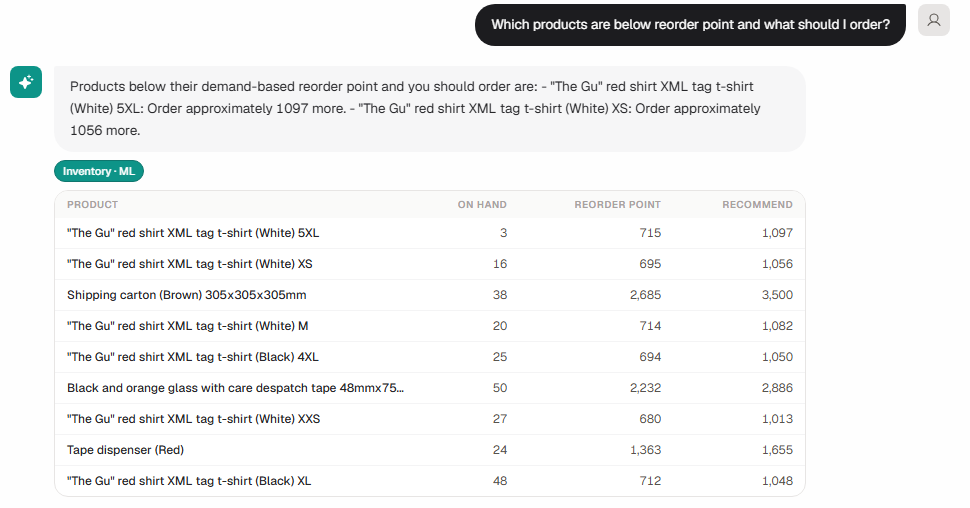
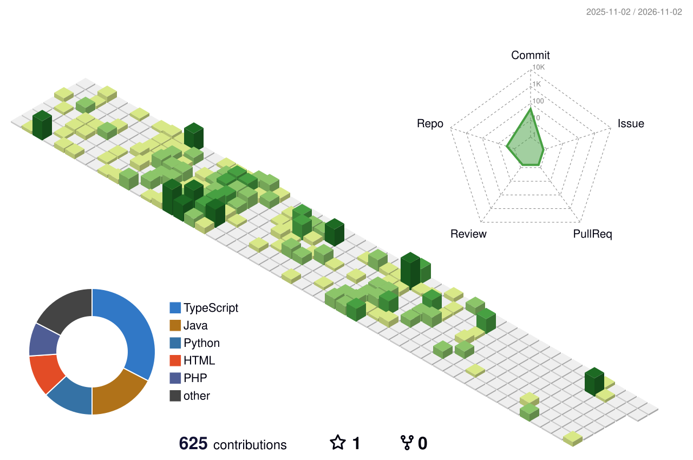

<picture>
  <source media="(max-width: 767px)" srcset="assets/hero-narrow.svg"/>
  
</picture>

  &nbsp;
  &nbsp;
  

## `~$ ls ~/shipped`

<picture>
  <source media="(max-width: 767px)" srcset="assets/impact-narrow.svg"/>
  
</picture>

*These live in private client repositories. I'm happy to walk through the architecture and code on a call.*

## `~$ whoami`

I'm a full-stack developer at **[SPID Technologie](https://spid-tech.com.tn)**, where I design, build, deploy and maintain business apps end to end. I'm on track to become a **software engineer** once I finish my degree.

In the evenings I'm studying for a software engineering degree at **IIT** (expected 2027), on top of a **B.Sc. in Big Data & Data Analysis**. I speak Arabic, French and English.

## `~$ cat ship.log`

<picture>
  <source media="(max-width: 767px)" srcset="assets/ship-log-narrow.svg"/>
  
</picture>

## `~$ ls ~/public`

### HELM · end-to-end BI platform &nbsp;

An academic capstone built on **WideWorldImporters**, taking raw OLTP rows all the way to a local AI analyst. It runs fully on-prem with no cloud APIs, and the assistant answers from real cube query results instead of guessing.

  

### JobLinker · full-stack job board &nbsp;

A job board with separate spaces for **candidates, recruiters and admins**. MIT licensed.

- **Frontend:** React 19, TypeScript, Vite, Tailwind v4, shadcn/ui, React Router 7
- **Backend:** Express 5 + TypeScript, JWT role-based access control, bcrypt, Multer, Nodemailer
- **Data:** PostgreSQL with raw SQL and no ORM, in a layered architecture with dependency inversion
- **Quality:** bilingual FR / EN UI, and **Lighthouse accessibility ≥ 90 enforced in GitHub Actions**

  

## `~$ which --all`

<picture>
  <source media="(max-width: 767px)" srcset="assets/stack-narrow.svg"/>
  
</picture>

## `~$ git log --graph`

<picture>
  <source media="(prefers-color-scheme: dark)" srcset="profile-3d-contrib/profile-night-green.svg"/>
  <source media="(prefers-color-scheme: light)" srcset="profile-3d-contrib/profile-green-animate.svg"/>
  
</picture>

## `~$ logout`

Have a product to ship, or a system to keep running? Reach me on **[LinkedIn](https://www.linkedin.com/in/thamer-k/)** or at **[tkhaskhoussi@gmail.com](mailto:tkhaskhoussi@gmail.com)**.

<picture>
  <source media="(max-width: 767px)" srcset="assets/footer-narrow.svg"/>
  
</picture>

